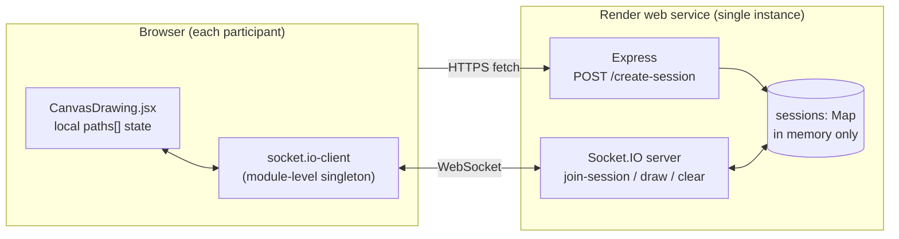

# Project Audit & Roadmap — Collaborative Whiteboard ("TeamSketch")

> Audit date: 2026-10-10 · Commit audited: `33dfe25` (branch `main`, clean tree)
> Scope: the whole repository (`backend/`, `frontend/`), local build, lint and dependency audit, a scripted protocol probe against a locally running backend, and online research.
> No application code was changed during this audit.

---

## How to read this document

Every finding has one of these evidence labels:

| Label | Meaning |
|---|---|
| **[Verified – run]** | Reproduced by running a command or script during this audit (output quoted). |
| **[Verified – code]** | Follows directly from reading the code. The behavior is unambiguous, but it was not exercised in a browser. |
| **[Likely]** | Strongly suggested by the code or documentation but not reproduced. Verify it before relying on it. |
| **[Assumption]** | A product or hiring judgment, not a fact about the code. |

**Limitations of this audit**
- I did not drive the UI in a real browser, so frontend behavior is **[Verified – code]** unless stated otherwise.
- I checked that the live sites respond (`https://collaoboard.netlify.app/` returned HTTP 200, and `POST https://collab-whiteboard-5uu2.onrender.com/create-session` returned HTTP 200 in about 2.7 s). I did not test drawing on the live deployment. Note that the backend check created one empty in-memory session on the live server.
- No usage, performance or user data exists in the repo, so this document contains **no metrics about real users**.
- Job-market research is a small sample of public sources. It indicates trends and does not measure the market.

---

## 1. Project overview and current status

### What it is
A real-time, link-shareable whiteboard. A user clicks **Start Collaborating → Create New Session** and gets a URL like `/session/<uuid>`. Everyone who opens that URL draws on the same canvas.

### Tech stack (installed versions from the lockfiles)
| Layer | Technology |
|---|---|
| Frontend | React 18.3.1, Vite 5.3.5, React Router 6.26.0, Tailwind CSS 3.4.7, socket.io-client 4.7.5 |
| Rendering | Inline SVG (`<path>`, `<rect>`, `<ellipse>`, `<text>`) |
| Backend | Node.js (ESM), Express 4.19.2, Socket.IO 4.7.5, uuid 10 |
| State on server | In-memory `Map` (`backend/index.js:31`) |
| Hosting | Netlify (frontend, SPA redirect in `frontend/public/_redirects`), Render (backend, hardcoded URL) |

### Architecture (current)



**Data model:** each session is `{ paths: [] }`, an append-only list of finished shapes. Clients send a shape only on mouse-up, and the server appends it and broadcasts it to the room. Late joiners receive the whole list via `load-canvas`.

### Feature inventory
| Feature | Status | Evidence |
|---|---|---|
| Create a shareable session | Works | `backend/index.js:33-38`, `CreateSessionButton.jsx:8-22` |
| Freehand pencil | Works (mouse only) | `CanvasDrawing.jsx:62-128` |
| Rectangle / ellipse | Works (mouse only) | `CanvasDrawing.jsx:105-118` |
| Text | **Buggy** (see I-5, I-6) | `CanvasDrawing.jsx:141-149, 225` |
| Eraser | **Fake**: paints white strokes | `CanvasDrawing.jsx:185` |
| Color and stroke width | Works | `Toolbar.jsx:28-41` |
| Clear board | Works, no confirmation or undo | `CanvasDrawing.jsx:172-175` |
| Zoom (wheel and buttons) | Partially works (see I-8) | `CanvasDrawing.jsx:80-97`, `ZoomControls.jsx` |
| Pan | **Missing.** `pan` changes only as a side effect of wheel zoom | `CanvasDrawing.jsx:15, 91-94` |
| Live strokes while drawing | **Missing.** Peers see a stroke only after mouse-up | `CanvasDrawing.jsx:159-162` |
| Persistence across server restarts | **Missing** | `backend/index.js:31` |
| Touch / pen / mobile | **Missing.** Only `onMouse*` handlers | `CanvasDrawing.jsx:275-279` |
| Undo / redo, export, presence, cursors | **Missing** | — |
| Tests, CI, root README, LICENSE | **Missing** | `backend/package.json:8` (`"test": "echo \"Error: no test specified\" && exit 1"`) |

### Health checks run during the audit
| Check | Result |
|---|---|
| `npm ci` (both packages) | OK |
| `npm run build` (frontend) | **OK.** JS bundle 208.85 kB (67.36 kB gzip), CSS 8.18 kB |
| `npm run lint` (frontend) | **FAILS: 9 errors**, all `react/prop-types` in `Toolbar.jsx` and `ZoomControls.jsx` |
| `npm audit` backend | **14 vulnerabilities** (3 low, 3 moderate, 7 high, 1 critical), all marked "fix available via `npm audit fix`" |
| `npm audit` frontend | **30 vulnerabilities** (1 low, 7 moderate, 22 high). Production-only (`--omit=dev`) flags `@remix-run/router`, `socket.io-parser`, `ws` |
| Tests | None exist |

---

## 2. The real-world problem and proposed solution

### Problem
Small remote groups often need to **sketch an idea together right now**. Examples include explaining an architecture in a call, tutoring a math problem, pairing in a mock interview, or planning a sprint. Heavy tools (Miro, FigJam) require accounts and onboarding. The value is **zero-friction, link-based, real-time sketching**.

### Honest positioning **[Assumption]**
Mature open-source tools such as [Excalidraw](https://github.com/excalidraw/excalidraw) and [tldraw](https://github.com/tldraw/tldraw) already solve this very well. A reviewer will compare against them. The project will not win on feature count. It **can** win as a portfolio piece by showing that you understand the hard engineering problems underneath a collaborative app:

1. **Consistency**: every participant sees the same board, including after reconnects.
2. **Durability**: boards survive server restarts. This matters on Render's free tier, which spins down after 15 idle minutes and wipes local state ([Render docs](https://render.com/docs/free)).
3. **Responsiveness**: live in-progress strokes and presence (cursors), without flooding the network.
4. **Safety**: the server validates untrusted input and bounds memory.
5. **Verifiability**: automated tests prove multi-client behavior.

### Proposed solution direction
Keep the current stack (React + Socket.IO), which is a reasonable and widely used choice. Evolve it into a **reliable, tested, persistent multiplayer whiteboard with a clear consistency model**. Optionally pick a niche to make it memorable **[Assumption]**. One example is "a whiteboard for system-design interview practice", with a timer, a read-only share link and PNG export. Choose a niche only if you will actually use it, and do not add features just for the niche.

---

## 3. Key issues and their evidence

Severity: 🔴 High (broken behavior or security), 🟠 Medium, 🟢 Low.

### 3.1 Correctness bugs

**I-1 🔴 The sender gets every one of its own strokes twice [Verified – run]**
- `CanvasDrawing.jsx:160-161` adds the shape locally, then emits `draw`.
- `backend/index.js:55` broadcasts with `io.to(sessionId).emit(...)`, which **includes the sender**. The [Socket.IO rooms docs](https://socket.io/docs/v4/rooms/) say `socket.to(room)` excludes the sender and `io.to(room)` does not.
- The client handler at `CanvasDrawing.jsx:32-34` appends the echoed stroke again.
- Probe output: `[1] sender received its own draw back 1x; peer received 1x`.
- Impact: the sender's local `paths` holds duplicates, so it renders 2× the SVG nodes. Once you add undo or IDs, the client state diverges from the server's.
- Fix: use `socket.to(sessionId).emit("draw", path)`, or give each shape a client-generated `id` and dedupe on receipt.

**I-2 🔴 Session links die silently after any server restart [Verified – run + docs]**
- Sessions live only in memory (`backend/index.js:31`). Render free instances spin down after 15 minutes without traffic, and local state is lost on every restart or redeploy ([Render docs](https://render.com/docs/free)).
- After a restart, `join-session` finds no session (`index.js:45-48`) and `draw` silently drops the event (`index.js:52-56`). The client receives no error.
- Probe output: `[2] draw in unknown/expired session reached peer 0x (no error sent to client)`.
- Impact: a user opens a shared link the next day. Each person can draw locally, but **nothing syncs and nothing tells them why**.
- Fix: persist sessions (see §5.2), and emit `session-not-found` so the UI can say so.

**I-3 🔴 A client that reconnects stops receiving updates [Verified – run + docs]**
- `join-session` is emitted once, in a `useEffect` (`CanvasDrawing.jsx:29-30`). Socket.IO removes a socket from all rooms on disconnect ([rooms docs](https://docs.w3cub.com/socketio~4/rooms): *"Upon disconnection, sockets leave all the channels they were part of automatically"*).
- Probe output: `[4] after peer reconnect (connected=true), peer received 0x new draws (room not rejoined)`.
- Impact: Wi-Fi blips, laptop sleep and server restarts all leave a user looking at a stale board that appears "connected".
- Fix: emit `join-session` inside `socket.on("connect", ...)` and re-sync the full state on rejoin. Optionally enable [connection state recovery](https://socket.io/docs/v4/connection-state-recovery).

**I-4 🟠 Dragging with the text tool creates junk shapes [Verified – code]**
- In `draw()` (`CanvasDrawing.jsx:105-124`), the `text` tool is not in `["rectangle","circle"]`, so it falls into the `else` branch: `currentPath = \`${prev.currentPath} L ...\``. `prev.currentPath` is `null` for text (line 69-71), which produces the string `"null L x y"`.
- In `stopDrawing()`, if the text box is empty, the `else if (drawingState.currentPath)` branch (line 150) is truthy. It emits `{ d: "null L …", tool: "text" }` to everyone, and that renders an empty `<text>` element.
- The preview also renders `<path d="null L …">` (line 284-290), an invalid path.
- Fix: return early in `draw()` for `text`, and restructure the logic with an explicit tool switch.

**I-5 🟠 Committed text loses its size [Verified – code]**
- The text shape is created without `strokeWidth` (`CanvasDrawing.jsx:142-148`), but rendering uses `fontSize={\`${path.strokeWidth * 5}px\`}` (line 225), which gives `"NaNpx"`. The browser falls back to the default size, so text shrinks after you place it. The preview (line 328) uses the real `strokeWidth`.
- Fix: include `fontSize` in the text shape, and add a unit test for the shape factory.

**I-6 🟠 Text tool UX is inverted [Verified – code]**
- The user must type in a floating input first (`CanvasDrawing.jsx:261-271`) and then click the canvas. Most tools work the other way around: click where you want the text, then type there. There is also no multi-line text and no way to edit text after placing it.

**I-7 🟠 The eraser is a white pen [Verified – code]**
- `CanvasDrawing.jsx:185, 287` render eraser strokes with `#FFFFFF`. The "erased" content is still in the data, still synced, and still downloaded by every joiner. It would show through on any non-white background or export.
- Fix: implement an object eraser (hit-test and delete by shape `id`). This requires shape IDs (see §5.1).

**I-8 🟠 Zoom misbehaves [Verified – code]**
- `handleWheel` clamps zoom (line 86-89) but always shifts `pan` by the *unclamped* delta (line 91-94). At 10% or 500% zoom, scrolling keeps sliding the canvas.
- `ZoomControls` buttons change only `zoom`, never `pan`, so they zoom around the top-left corner, not the viewport center (`ZoomControls.jsx:5,12`). The `minZoom`, `maxZoom` and `zoomStep` props passed at `CanvasDrawing.jsx:255-257` are ignored.
- `e.preventDefault()` inside React's `onWheel` (line 82) **[Likely]** has no effect. React registers wheel listeners as passive, and browsers ignore `preventDefault` in passive listeners ([Chrome scrolling intervention](https://developer.chrome.com/blog/scrolling-intervention-2)). Check for a console warning. Fix: attach a native listener with `{ passive: false }` via a ref.

**I-9 🟠 No touch or pen support [Verified – code]**
- Only `onMouseDown/Move/Up/Leave` handlers (`CanvasDrawing.jsx:275-279`). On phones and tablets, a large share of whiteboard use, drawing does not work.
- Fix: switch to [Pointer Events](https://developer.mozilla.org/en-US/docs/Web/API/Pointer_events) with `setPointerCapture` and CSS `touch-action: none` on the SVG.

**I-10 🟢 Smaller issues [Verified – code]**
- The server log always says "port 3000" (`backend/index.js:74`), even when `PORT` differs. Confirmed: the probe server ran on 3999 and logged "port 3000".
- `CreateSessionButton.jsx` has no `res.ok` check (line 17), no loading state, and no user-visible error. A Render cold start can take about one minute ([Render docs](https://render.com/docs/free)), and during it the button looks dead.
- The two-click start flow (`Share.jsx` → `CreateSessionButton.jsx`) adds a step that does nothing.
- There is no copy-to-clipboard button for the share link.
- `z-4` (`CanvasDrawing.jsx:262`) is not a default Tailwind class.
- Leftover `console.log` calls (`CreateSessionButton.jsx:6,10`, `backend/index.js:35,41,68`).
- The socket is created at module import time (`CanvasDrawing.jsx:7-9`), so it is not tied to the component lifecycle.
- Rendered SVG elements use array `index` as React `key` (`CanvasDrawing.jsx:183…`). This is fragile once deletion or undo exists.

### 3.2 Security and abuse risks

**S-1 🔴 No input validation on socket events [Verified – run]**
- The server stores and rebroadcasts whatever object arrives (`backend/index.js:51-57`). Probe output: `[3] stored paths: 2; junk object stored = true; approx bytes sent on join = 500099`. One 500 KB junk object was accepted and is now sent to every future joiner.
- Frontend XSS risk was assessed as **low [Verified – code]**. Text is rendered as React children, which React escapes, and there is no `dangerouslySetInnerHTML`. Validation still matters for memory, bandwidth and broken renders.
- Fix: validate each event against a schema (for example [zod](https://zod.dev)): an allow-listed `tool`, numeric bounds, a capped text length, a capped number of path points, and a hex color regex.

**S-2 🔴 Unbounded memory and denial-of-service surface [Verified – code]**
- `POST /create-session` is unauthenticated and not rate-limited, and sessions are never deleted (`index.js:33-38`). Paths per session are unbounded. Socket.IO's default per-message limit (`maxHttpBufferSize`, 1 MB per the [server options docs](https://socket.io/docs/v4/server-options/)) still allows many large messages.
- Fix: per-IP rate limit on session creation, per-socket event rate limit, a lower `maxHttpBufferSize`, a session TTL with cleanup, and caps on shapes per session.

**S-3 🟠 Anyone with the link can wipe the board [Verified – code]**
- `clear` has no permission check or confirmation (`index.js:59-65`). Unguessable UUID links are a valid "capability URL" model, but a single link mixes view and edit rights.
- Fix (optional): an owner token for destructive actions, plus a separate read-only link.

**S-4 🟠 Known-vulnerable dependencies [Verified – run]**
- Backend: 14 advisories, including `proxy-addr` (critical, [GHSA-jqcg-44mw-7w3h](https://github.com/advisories/GHSA-jqcg-44mw-7w3h)), `path-to-regexp` ReDoS ([GHSA-rhx6-c78j-4q9w](https://github.com/advisories/GHSA-rhx6-c78j-4q9w)), and `body-parser` DoS ([GHSA-qwcr-r2fm-qrc7](https://github.com/advisories/GHSA-qwcr-r2fm-qrc7)).
- Frontend production dependencies: `socket.io-parser` ([GHSA-677m-j7p3-52f9](https://github.com/advisories/GHSA-677m-j7p3-52f9)), `ws` ([GHSA-96hv-2xvq-fx4p](https://github.com/advisories/GHSA-96hv-2xvq-fx4p)), and `@remix-run/router`.
- `npm audit` reports a non-breaking fix for each of these. Run `npm audit fix`, then re-run the build and tests.

**S-5 🟢 Configuration hygiene [Verified – code]**
- The backend URL is hardcoded in two places (`CanvasDrawing.jsx:7`, `CreateSessionButton.jsx:12`). Use `import.meta.env.VITE_API_URL` ([Vite env docs](https://vite.dev/guide/env-and-mode)).
- `credentials: true` in CORS (`index.js:18, 27`) and `withCredentials: true` (`CanvasDrawing.jsx:8`) are unnecessary, because no cookies are used.
- There are no security headers (consider [helmet](https://helmetjs.github.io/)).

### 3.3 Architecture and technical debt
| ID | Issue | Evidence |
|---|---|---|
| A-1 | One 340-line component mixes networking, input handling, geometry, rendering and UI state | `frontend/src/CanvasDrawing.jsx` |
| A-2 | Shapes have no `id`, `authorId` or timestamp, which blocks undo, a real eraser, dedupe and selection | `CanvasDrawing.jsx:135-156` |
| A-3 | The backend is a single file that calls `listen()` at import, so it is hard to test | `backend/index.js:73` |
| A-4 | Unused dependencies: `recoil` (repository [archived on 2025-01-01](https://github.com/facebookexperimental/Recoil)) and `dotenv` (a Node library, irrelevant in Vite client code). Neither is imported anywhere in `frontend/src` | `frontend/package.json:13,17` |
| A-5 | Unused assets: `src/assets/logo2.svg` (94 KB), `public/art.png`, `public/vite.svg`, and the empty `App.css` | grep found no references |
| A-6 | Template `frontend/README.md`, no root README, no LICENSE, no `.env.example` | repo tree |
| A-7 | Low-signal commit history (`ll`, `optimize`, `added style`). 16 commits over 2024-08-05 → 2024-08-16 | `git log` |
| A-8 | Naming is inconsistent: "TeamSketch" (`index.html:7`), "Collab_whiteboard" (repo), "collaoboard" (Netlify) | — |

### 3.4 UX and accessibility
- Toolbar buttons have only `` and no `aria-label`, `aria-pressed` or visible tooltip. The color and size inputs have no labels (`Toolbar.jsx:16-41`) **[Verified – code]**.
- There are no keyboard shortcuts (for example P/E/R/O/T, Ctrl+Z).
- `Clear` is destructive and has no confirmation or undo.
- The toolbar uses a fixed `h-[80vh]` with absolute positioning, which crowds small screens **[Likely]**.
- There is no indicator for connection status, number of participants, or "session expired".

### 3.5 Performance
- Freehand strokes are stored as an ever-growing SVG `d` string, rebuilt on every `mousemove` with a React state update (`CanvasDrawing.jsx:120-123`). That is fine for a few hundred shapes. Store points as arrays, throttle with `requestAnimationFrame`, and simplify or smooth them (for example [perfect-freehand](https://github.com/steveruizok/perfect-freehand)) **[Likely]**: no profiling was done.
- `load-canvas` ships the entire history on every join, and history includes erased strokes (see I-7) and duplicates. Probe [3] shows a single message can be about 500 KB.
- The bundle (67 kB gzip) is reasonable. Removing the unused deps will not change it much, because tree-shaking already drops them, but it cleans `package.json`.

---

## 4. Internet research and reference links

### Similar successful projects (what "good" looks like)
| Project | Lesson for this repo |
|---|---|
| [Excalidraw](https://github.com/excalidraw/excalidraw) + [excalidraw-room](https://github.com/excalidraw/excalidraw-room) | Uses a **Socket.IO relay** like this project. Clients own the scene, elements have IDs and versions for reconciliation, scenes are stored separately, and end-to-end encryption keys live in the URL `#fragment`, which is never sent to the server. This shows your stack choice is legitimate. |
| [tldraw](https://github.com/tldraw/tldraw), [collaboration docs](https://tldraw.dev/sdk-features/collaboration), [multiplayer starter kit](https://tldraw.dev/starter-kits/multiplayer) | A record-based store with a sync server, presence and cursors are first-class, and the starter kit runs on Cloudflare Durable Objects (one object per room). |
| [Yjs](https://github.com/yjs/yjs) / [docs](https://docs.yjs.dev) | A CRDT library with an *awareness* protocol for cursors and presence. It is the standard answer to "how do you resolve concurrent edits offline?" A good **stretch goal or ADR topic**, not a requirement. |

### Official documentation relied on
- Socket.IO: [Rooms](https://socket.io/docs/v4/rooms/) · [Connection state recovery](https://socket.io/docs/v4/connection-state-recovery) · [Server options](https://socket.io/docs/v4/server-options/) · [Testing (Jest/Vitest examples)](https://socket.io/docs/v4/testing/) · [Redis adapter](https://socket.io/docs/v4/redis-adapter/) for multi-instance scaling
- Render: [Free tier limits (spin-down, ephemeral filesystem)](https://render.com/docs/free)
- Vite: [Env variables and modes](https://vite.dev/guide/env-and-mode)
- MDN: [Pointer events](https://developer.mozilla.org/en-US/docs/Web/API/Pointer_events)
- Chrome: [Passive wheel listener intervention](https://developer.chrome.com/blog/scrolling-intervention-2)
- OWASP: [WebSocket Security Cheat Sheet](https://cheatsheetseries.owasp.org/cheatsheets/WebSocket_Security_Cheat_Sheet.html)
- Testing tools: [Vitest](https://vitest.dev) · [Playwright browser contexts (multi-user tests)](https://playwright.dev/docs/browser-contexts)
- Recoil archive status: [github.com/facebookexperimental/Recoil](https://github.com/facebookexperimental/Recoil) ("archived by the owner on Jan 1, 2025")

### Portfolio and hiring guidance (practitioner opinion, not survey data)
- [Scrimba: How to build a web developer portfolio that gets you hired](https://scrimba.com/articles/how-to-build-a-web-developer-portfolio-that-gets-you-hired)
- [DevPlaybook: Developer portfolio checklist](https://devplaybook.cc/blog/developer-portfolio-checklist-20-things-hiring-managers)
- [Hakia: Building a portfolio that gets hired](https://hakia.com/skills/building-portfolio/)

Common themes across these sources: a few deep projects beat many shallow ones; every project needs a working live demo plus a README covering what, why, how to run, the stack and design decisions; tutorial clones count only if meaningfully extended; and git history is visible to reviewers.

### Job-requirement signal (small sample, limited)
Public junior and mid full-stack postings for React and Node commonly list REST or WebSocket APIs, testing, Git workflows and CI/CD, and cloud deployment. Examples: [Jobberman junior full-stack (React/Node)](https://www.jobberman.com/listings/junior-full-stack-developer-react-nodejs-0k2v6m) and [ITJobsWatch: WebSockets vacancies](https://www.itjobswatch.co.uk/search?j=2&q=WebSockets&r=1). **Limitation:** I did not do a systematic job-market analysis. Validate against 10–20 postings in your target location and level.

---

## 5. Recommended features and technical improvements

### 5.1 Core refactor: a real shape model (unlocks almost everything)
```js
// shared shape (validated on server)
{ id: "uuid", type: "pencil" | "rect" | "ellipse" | "text",
  points?: [[x,y],...], x?, y?, w?, h?, text?, fontSize?,
  style: { stroke: "#rrggbb", strokeWidth: 1..20 },
  authorId: "socket/user id", createdAt: 1730000000000 }
```
Operations become explicit events: `shape:add`, `shape:update` (live stroke), `shape:delete`, `board:clear`, `cursor:move`. The server keeps an ordered log or map keyed by `id`. That gives you dedupe (I-1), a real eraser (I-7), undo/redo, and stable React keys.

### 5.2 Must-have improvements (high value, proportionate effort)
| Improvement | Why it matters | Notes |
|---|---|---|
| Fix I-1 to I-5 and the reconnect handling | The app must work correctly first | — |
| **Persistence** | Fixes dead links (I-2); demonstrates data modeling | Store the shape list per board. Options: a managed Postgres (JSONB `shapes` column or a `shapes` table) or Redis. Render free instances cannot keep local files. Debounce writes, for example a snapshot every few seconds plus on last-leave. |
| Session-not-found / expired UI | Removes silent failure | Server emits `session-error`; client shows "This board no longer exists → Create a new one". |
| Input validation and limits | Security basics reviewers look for | zod schemas, `maxHttpBufferSize`, per-socket rate limit, shapes-per-board cap, board TTL. |
| Pointer Events + `touch-action: none` | Mobile and pen support | Replace the mouse handlers. |
| Undo / redo (per user) | Expected in any editor; a good algorithm talking point | An undo stack of your own op IDs. Undo emits the inverse op. |
| Object eraser | Correct behavior instead of white ink | Hit-test against the shape bounding box or path. |
| Pan (space-drag or hand tool) + zoom clamp fix | Basic infinite-canvas navigation | Pure `screenToWorld` / `zoomAt` helpers, unit-tested. |
| Live strokes + presence (cursors, names, participant count) | This is what makes it feel "real-time" | Throttle to roughly 20–30 msgs/s with `requestAnimationFrame`. Use volatile emits for cursors. |
| Export PNG/SVG | Practical value; easy with SVG | Serialize the `<svg>`, then draw it to a canvas for PNG. |
| Connection status indicator + cold-start loading state | Honest UX on free hosting | "Waking server…" spinner, then "Reconnecting…" banner. |

### 5.3 Nice-to-have (only after the above)
- Read-only share link and owner token for `clear` (S-3).
- Select, move and resize shapes.
- A dark theme, which also exposes the fake eraser if not fixed.
- An ADR comparing "server-ordered op log (current)" with "CRDT (Yjs)" for concurrency. Implementing Yjs is optional.
- Horizontal scaling write-up: Socket.IO [Redis adapter](https://socket.io/docs/v4/redis-adapter/) plus sticky sessions. Document it rather than build it unless you need it.

### 5.4 Remove or simplify
- Remove `recoil` and `dotenv` from `frontend/package.json` (A-4).
- Delete unused assets (A-5) and the empty `App.css`.
- Collapse `Share.jsx` + `CreateSessionButton.jsx` into one landing page with a single "New board" button that **navigates directly** into the board and shows a copy-link button.
- Remove the unused `ZoomControls` props or implement them, and remove the debug `console.log`s.

### 5.5 Avoid (overengineering for this project) **[Assumption]**
Microservices, Kubernetes, a custom CRDT implementation, user accounts or OAuth before persistence works, AI features, and a TypeScript rewrite plus a framework swap at the same time. Convert to TypeScript incrementally if you want it; shared event types are a good start.

---

## 6. Prioritized action plan

Effort: S ≈ < half a day, M ≈ 1–2 days, L ≈ 3+ days. These are rough estimates for one developer.

### Phase 0: Hygiene (impact high for reviewers, effort S)
| # | Task | Files | How to test |
|---|---|---|---|
| 0.1 | Root `README.md` (see §8), `LICENSE`, `.env.example` for both packages | new files | Fresh clone → follow the README → app runs |
| 0.2 | Move URLs to env: `VITE_API_URL` (frontend), `CORS_ORIGINS` and `PORT` (backend); fix the port log | `CanvasDrawing.jsx:7`, `CreateSessionButton.jsx:12`, `backend/index.js:9-13,74` | Run locally with `.env` and point it to `localhost:3000` |
| 0.3 | `npm audit fix` in both packages | `package-lock.json` ×2 | `npm audit` shows 0 high/critical; build passes |
| 0.4 | Fix lint (adopt PropTypes, or migrate files to TS) and remove unused deps and assets | `Toolbar.jsx`, `ZoomControls.jsx`, `frontend/package.json` | `npm run lint` exits 0 |
| 0.5 | Use descriptive commit messages from now on (e.g. Conventional Commits) | — | `git log` reads like a changelog |

### Phase 1: Correctness (impact high, effort M)
| # | Task | Files | How to test |
|---|---|---|---|
| 1.1 | Broadcast with `socket.to(room)`; add shape `id`s; dedupe on client | `backend/index.js:55`, `CanvasDrawing.jsx:32-34,159-162` | Integration test: sender receives 0 echoes; two clients end with identical shape lists |
| 1.2 | Rejoin room on every `connect`; full resync on rejoin | `CanvasDrawing.jsx:29-49` | Integration test: force-close the engine, reconnect, receive the next draw (the inverse of probe [4]) |
| 1.3 | `session-error` event plus "board not found" UI | `backend/index.js:43-57`, new UI component | Join a random UUID → error screen shown |
| 1.4 | Fix text tool bugs (I-4, I-5) and redesign it as click-then-type | `CanvasDrawing.jsx:99-149,218-229` | Unit test of the shape factory; e2e test: place text, reload, same size |
| 1.5 | Fix zoom clamp drift, zoom-to-center buttons, non-passive wheel listener | `CanvasDrawing.jsx:80-97`, `ZoomControls.jsx` | Unit tests of the `zoomAt()` math: the world point under the cursor stays fixed; no drift at bounds |
| 1.6 | Pointer Events + `touch-action: none` | `CanvasDrawing.jsx:272-281` | Chrome DevTools device emulation; real phone on the deployed site |

### Phase 2: Robustness and security (impact high, effort M)
| # | Task | Files | How to test |
|---|---|---|---|
| 2.1 | Split the backend: `app.js` (creates app/io, no listen), `server.js` (listen), `boards.js` (store), `schemas.js` (zod) | `backend/` | Tests can import `app.js` and bind a random port |
| 2.2 | Validate every event and reject with an error ack | `backend/schemas.js` | Tests: unknown tool, 2 MB text, 1e6 points, bad color → rejected, not stored |
| 2.3 | Rate limits (create-session per IP, events per socket), `maxHttpBufferSize`, shapes-per-board cap, board TTL | `backend/app.js` | Tests: N+1th event in window rejected; expired board purged |
| 2.4 | Persistence layer behind an interface (`MemoryStore` for tests, `PostgresStore`/`RedisStore` for prod) | `backend/boards.js` | Test: create board, add shapes, restart server process, rejoin, shapes present |
| 2.5 | `GET /healthz`, structured logging, remove `credentials: true` | `backend/app.js` | `curl /healthz` → 200 |

### Phase 3: Collaboration features (impact medium-high, effort M–L)
| # | Task | How to test |
|---|---|---|
| 3.1 | Refactor `CanvasDrawing.jsx` into `useBoardSocket()`, `useViewport()`, `lib/shapes.js`, `lib/geometry.js`, and `<ShapeRenderer>` | Existing tests stay green; the component drops well under 150 lines |
| 3.2 | Undo/redo (Ctrl+Z / Ctrl+Shift+Z) for own operations | Unit tests of the reducer; e2e test: user A undoes, user B sees removal |
| 3.3 | Object eraser using hit-testing | Unit test hit-test geometry; e2e test: erase removes shape for everyone and from storage |
| 3.4 | Live in-progress strokes (throttled) + cursors and participant list | e2e test with two Playwright contexts: B sees A's cursor and partial stroke |
| 3.5 | Pan tool, PNG/SVG export, copy-link button, keyboard shortcuts, labelled toolbar | Manual + Playwright; axe accessibility scan |

### Phase 4: Quality gates and delivery (impact high for hiring, effort S–M)
| # | Task | How to test |
|---|---|---|
| 4.1 | Vitest unit tests (geometry, shape factory, reducers, schemas) | `npm test` |
| 4.2 | Socket integration tests following the [official testing guide](https://socket.io/docs/v4/testing/) | `npm test` in `backend/` |
| 4.3 | One Playwright e2e test with **two browser contexts** drawing on the same board | `npx playwright test` |
| 4.4 | GitHub Actions: install → lint → test → build on every PR; `npm audit --audit-level=high` | Green badge in the README |
| 4.5 | Optional: Dockerfile / `docker-compose.yml` (backend + Postgres/Redis) for one-command local setup | `docker compose up` works on a fresh machine |

### Phase 5: Portfolio packaging (impact very high, effort S)
See §8.

---

## 7. Testing, security, performance and deployment

### Testing strategy (none exists today)
| Layer | Tool | What to cover |
|---|---|---|
| Unit | Vitest | `screenToWorld`, `zoomAt` (cursor-anchored, clamped), shape factories (text includes `fontSize`), normalization of negative rect drags, undo reducer, hit-testing, zod schemas |
| Integration | Vitest + real Socket.IO server on a random port | No echo to sender; late joiner gets full state; rejoin after reconnect; unknown board → error; invalid payload rejected; rate limit; persistence across a store reload |
| End-to-end | Playwright, two contexts | A draws → B sees it; B reloads → still there; clear is reflected; mobile viewport drawing |
| Static | ESLint (passing), optional `tsc --noEmit` | CI gate |

Write regression tests first for the probe findings [1]–[4]. They are concrete, reproducible bugs, and "I wrote a failing test, then fixed it" is a strong interview story.

### Security checklist
- [ ] Schema validation on every socket event and HTTP body
- [ ] `maxHttpBufferSize` lowered; caps on shapes per board and points per stroke
- [ ] Rate limiting (HTTP + per-socket events)
- [ ] Board TTL and cleanup job
- [ ] CORS origins from env; no `credentials` unless needed; origin checked on the WebSocket handshake ([OWASP](https://cheatsheetseries.owasp.org/cheatsheets/WebSocket_Security_Cheat_Sheet.html))
- [ ] `helmet` on Express
- [ ] `npm audit` clean of high/critical; Dependabot enabled
- [ ] Optional: owner token for destructive ops; read-only link

### Performance checklist
- [ ] Points arrays instead of string concatenation; rAF-throttled updates
- [ ] Stroke simplification or smoothing
- [ ] Volatile emits for cursors; batching for live strokes
- [ ] Snapshot plus incremental ops on join, instead of replaying unbounded history
- [ ] Measure before and after with Chrome Performance panel or React Profiler, using, for example, 1,000 shapes. **Record real numbers only.**

### Deployment checklist
- [ ] Env-based config (`VITE_API_URL`, `CORS_ORIGINS`, `DATABASE_URL`/`REDIS_URL`)
- [ ] Persistent store outside the Render instance (its filesystem is ephemeral)
- [ ] Health endpoint; a cold-start message in the UI. A keep-alive pinger works around the free-tier intent, so choose deliberately and document the trade-off.
- [ ] Netlify deploy previews per PR; CI must pass before deploy
- [ ] README states the free-tier cold-start behavior honestly

---

## 8. Portfolio and recruiter presentation

### README.md (root): recommended outline
1. **Name + one-line pitch.** Pick one name everywhere (see A-8).
2. **Live demo link + 10–20 s GIF** of two browser windows drawing together. This is the single most persuasive asset.
3. **"Note: first load may take ~1 min (free hosting cold start)."** It prevents a reviewer from concluding the site is broken.
4. **Features**, listing only what actually works.
5. **Architecture diagram** (Mermaid, like §1, updated with the persistence store) plus an **event protocol table** (`event`, `direction`, `payload`, `validation`).
6. **Design decisions / trade-offs**: why Socket.IO over raw `ws`, why a server-ordered op log versus CRDTs, how reconnect and resync work, and what happens on a cold start.
7. **Running locally**: prerequisites, `.env.example`, two commands.
8. **Testing**: how to run unit, integration and e2e tests, plus the CI badge.
9. **Security considerations**: validation, limits, the capability-URL model.
10. **Known limitations and roadmap.** Honesty here reads as seniority.

### Visual assets
- A GIF of the two-window collaboration, and screenshots on desktop and mobile.
- The architecture diagram, and a sequence diagram of "join → load → draw → broadcast → reconnect → resync".
- Optional: a short case-study post (problem → bugs found → fixes → what you learned), linked from the README.

### What reviewers are likely to notice **[Assumption, based on the sources in §4]**
| Strengths to highlight | Weaknesses to fix before sharing |
|---|---|
| Real-time multi-user sync (not a CRUD clone) | Template README; no root README |
| Full stack: React + Node + WebSockets + two deploy targets | Lint fails; no tests; no CI |
| Zoom/pan coordinate math | High/critical npm advisories |
| Live demo exists | Hardcoded URLs; unused deps (archived Recoil) |
| | Boards vanish on restart; reconnect bug; echo duplication |
| | Commit messages like `ll` |
| | Repo hosted under a different GitHub account (`origin` is `ajayvish0/Collab_whiteboard`). Make sure the repo you link is on the profile you list on your resume, and that its history reflects your contributions. |

---

## 9. Resume suggestions and interview preparation

### Resume bullets (templates; fill in only what you actually build and measure)
Use them **only after implementing the corresponding work**. Replace `[…]` with real, measured values or delete the clause.

- Built a real-time collaborative whiteboard (React, Node.js, Socket.IO) supporting multi-user drawing via shareable links, deployed on Netlify and Render.
- Diagnosed and fixed sync-consistency bugs, including duplicate event echoes and lost room membership after reconnects, and added integration tests that reproduce each bug against a live Socket.IO server.
- Added durable board persistence with [Postgres/Redis], so boards survive server restarts on ephemeral free-tier hosting.
- Hardened the WebSocket API with schema validation, payload size limits and per-socket rate limiting, following OWASP WebSocket guidance.
- Implemented per-user undo/redo and object erasing on top of an ID-based operation model.
- Set up CI (GitHub Actions) running lint, unit, integration and two-browser Playwright e2e tests on every pull request [with N tests].
- Optimized freehand rendering with point arrays and rAF throttling, reducing [measured metric] from [X] to [Y] at [N] shapes.

Do not claim users, uptime, latency or performance numbers you have not measured.

### Interview talking points (prepare 1–2 minutes on each)
1. **Consistency model.** "The server is the single source of order. Clients send ops with IDs, the server appends and broadcasts to others, and late joiners get a snapshot." Know where it breaks: concurrent edits of the *same* shape, and offline edits. That is where CRDTs like Yjs come in.
2. **The echo bug (I-1).** The difference between `io.to(room)` and `socket.to(room)`, how you found it with a probe script, and why IDs plus idempotent handlers are the robust fix.
3. **Reconnects (I-3).** Rooms are server-side and cleared on disconnect, so the client rejoins on `connect` and resyncs. Explain the trade-offs of connection state recovery.
4. **Free-tier constraints (I-2).** Ephemeral filesystem and spin-down; how you chose a persistence store; snapshot frequency versus write cost.
5. **Coordinate systems.** Screen versus world coordinates, cursor-anchored zoom math, and the clamp bug.
6. **Security of anonymous real-time apps.** Capability URLs, validation, rate limits, memory bounds.
7. **Scaling.** One instance today. For many, you would add the Socket.IO Redis adapter and sticky sessions, or move to per-room actors (as in tldraw's Durable Objects starter). Explain what you would measure first.
8. **What you would do differently.** Start with a shape model with IDs, and write multi-client tests from day one.

Expect follow-ups such as "What happens if two users erase the same shape at once?", "How big can a board get before it is slow?" and "How do you test real-time code?"

---

## 10. Final checklist: what to do next

**This week (Phase 0–1)**
- [ ] Write a real root README with live link + GIF + cold-start note
- [ ] Move URLs to env vars; add `.env.example`; fix the port log
- [ ] `npm audit fix` both packages; confirm the build
- [ ] Fix lint; remove `recoil`, `dotenv` and unused assets
- [ ] Fix the echo (I-1), reconnect (I-3) and text tool bugs (I-4, I-5) — with regression tests
- [ ] Show an error UI for missing or expired boards (I-2, partial)

**Next (Phase 2)**
- [ ] Split the backend for testability; add zod validation and limits
- [ ] Add persistence plus board TTL
- [ ] Switch to Pointer Events (mobile)
- [ ] Add a GitHub Actions CI pipeline

**Then (Phase 3–5)**
- [ ] Shape IDs → undo/redo, object eraser
- [ ] Live strokes, cursors, participant list
- [ ] Pan tool, export, shortcuts, accessibility labels
- [ ] Two-context Playwright e2e test
- [ ] Architecture and sequence diagrams, design-decisions section, case-study post
- [ ] Update resume bullets with **only** what was built and measured

---

### Appendix A: Protocol probe used in this audit
A throwaway Node script (kept outside the repo) started `backend/index.js` on port 3999 and used `socket.io-client` to:
1. create a session, join with two clients, and emit one `draw` → `sender received its own draw back 1x; peer received 1x`
2. join a non-existent session with two clients and draw → `reached peer 0x (no error sent to client)`
3. emit a 500 KB object with `tool: "<script>"` → `junk object stored = true; approx bytes sent on join = 500099`
4. force a client's transport closed and let it auto-reconnect → `connected=true, peer received 0x new draws (room not rejoined)`

The server log printed `Server is running on port 3000` despite `PORT=3999`.

Use these four scenarios as your first integration tests.

### Appendix B: Commands run
```
npm ci                    # frontend, backend
npm run lint              # frontend → 9 errors (react/prop-types)
npm run build             # frontend → success
npm audit [--omit=dev]    # frontend 30, backend 14 vulnerabilities
curl (live frontend/backend availability) → 200 / 200
```
