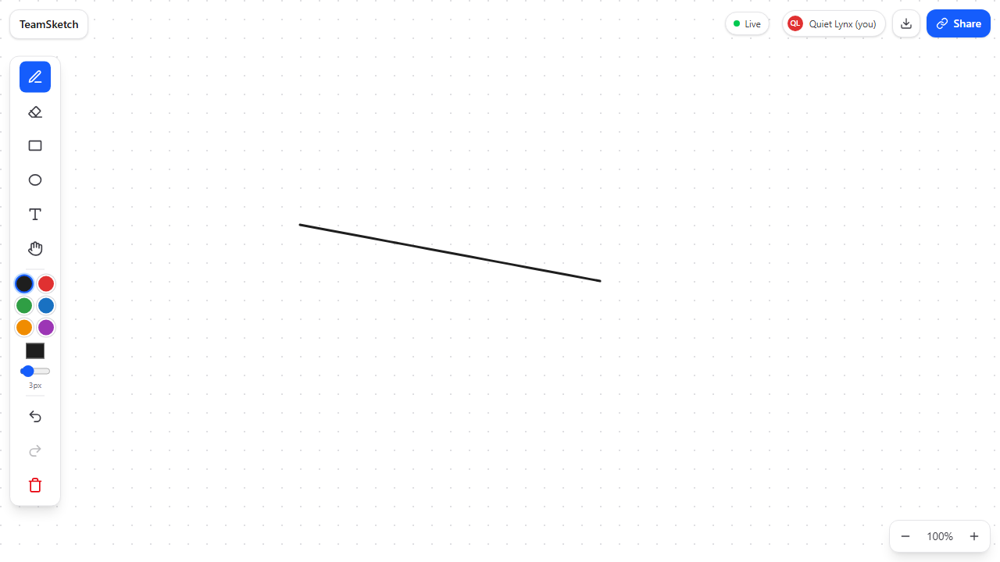
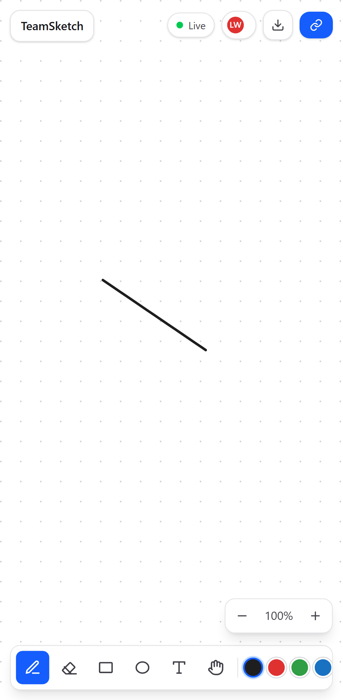
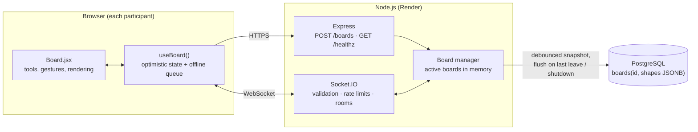

# TeamSketch: Real-time Collaborative Whiteboard

Create a board, share the link, and sketch together in real time. No sign-up needed.

[](https://github.com/ajayvish0/Collab_whiteboard/actions/workflows/ci.yml)

**Live demo:** https://collaoboard.netlify.app/

> **Note:** the backend runs on Render's free tier, which spins down after 15 minutes of inactivity. The first request after that can take about a minute; the app shows a "waking up the server" message meanwhile.

<!-- TODO: add a 10–20 s GIF of two browser windows drawing on the same board -->

| Desktop | Mobile |
|---|---|
|  |  |

---

## Features

- **Shareable boards:** one click creates a board with an unguessable URL (`/board/<uuid>`), plus a copy-link button.
- **Real-time sync:** shapes appear for everyone as they are drawn (live in-progress strokes), not only when finished.
- **Presence:** live cursors with names, avatars of everyone on the board, and a connection-status indicator.
- **Tools:** pencil (smoothed), rectangle, ellipse, multi-line text (click, then type; click existing text to edit it), object eraser, and pan.
- **Undo / redo** of your own changes (Ctrl+Z, Ctrl+Shift+Z / Ctrl+Y), synced to everyone.
- **Infinite canvas:** scroll or drag (hand tool, Space+drag, middle mouse) to pan; Ctrl+wheel, pinch or the +/− buttons to zoom (10%–500%).
- **Touch and pen:** Pointer Events, one-finger drawing and two-finger pinch-zoom.
- **Export** the board as PNG or SVG.
- **Persistence:** boards are stored in Postgres and survive restarts (in-memory fallback for development).
- **Resilience:** automatic rejoin and resync after a network drop; changes made while offline are sent when the connection returns. Missing or expired boards show a clear "not found" page.
- **Keyboard shortcuts:** P pencil, E eraser, R rectangle, O ellipse, T text, H hand, +/− zoom, 0 reset zoom.

## Tech stack

| Layer | Technology |
|---|---|
| Frontend | React 18, Vite 8, React Router 7, Tailwind CSS 4 |
| Rendering | SVG |
| Real-time | Socket.IO 4 (client and server) |
| Backend | Node.js 20+, Express 4, zod, helmet, express-rate-limit |
| Storage | PostgreSQL (JSONB snapshot per board), in-memory for dev/tests |
| Tests | Vitest (unit + Socket.IO integration), Playwright (two-browser e2e, mobile touch) |
| CI / hosting | GitHub Actions, Netlify (frontend), Render (backend + Postgres) |

## Architecture



### Consistency model

- **The server orders operations.** Clients send operations (`shape:add`, `shape:delete`, `board:clear`); the server applies them in arrival order and broadcasts them to *other* clients (`socket.to(room)`), so the sender never gets an echo.
- **Every shape has a client-generated UUID.** Adding an id that already exists is ignored, so a retried or duplicated message is harmless. This makes the offline queue safe to replay.
- **Optimistic UI.** Changes appear locally at once. If the server rejects a change (validation, board full), the client rolls it back and shows a message.
- **Reconnects.** Socket.IO rooms are server-side and cleared on disconnect, so the client re-emits `board:join` on every `connect`. The join reply is a full snapshot that becomes the new baseline, and queued offline operations are re-applied on top and sent.
- **Undo is per user**, implemented as inverse operations (`add` ↔ `remove`), so others see an undo like any other change.
- **Limits of this model:** concurrent edits to the *same* shape are last-writer-wins, and long offline sessions can resurrect shapes others deleted. A CRDT (e.g. Yjs) would handle these; it is not needed for draw/erase-style whiteboarding.

### Persistence

Active boards are kept in memory. After each change the board is written to Postgres after a short debounce (2 s), and it is flushed immediately when the last participant leaves and on `SIGTERM` (deploys). Boards not changed for `BOARD_TTL_DAYS` (default 30) are purged hourly. Without `DATABASE_URL`, an in-memory store is used and boards are lost on restart.

### Socket protocol

| Event | Direction | Payload | Notes |
|---|---|---|---|
| `board:join` | C → S (ack) | `{ boardId, name? }` | Ack: `{ ok, self, users, shapes }` or `{ ok: false, error: "not_found" \| "board_full" }` |
| `shape:add` | C → S (ack), S → others | `{ shapes: Shape[] }` | Idempotent by `id`; max 5000 shapes per board |
| `shape:delete` | C → S (ack), S → others | `{ ids: string[] }` | Ack lists what was actually deleted |
| `board:clear` | C → S (ack), S → others | `{}` | |
| `stroke:live` | C → S, S → others (volatile) | in-progress shape; pencil points are sent incrementally | Not stored |
| `stroke:end` | C → S, S → others | `{ id }` | Discards a cancelled live stroke |
| `cursor:move` | C → S, S → others (volatile) | `{ x, y }` (world coordinates) | Throttled to 20/s |
| `presence:join` / `presence:leave` | S → others | user / `{ userId }` | |

`Shape` is `{ id, type: "pencil" | "rect" | "ellipse" | "text", style: { stroke: "#rrggbb", strokeWidth } }` plus `points` (pencil), `x, y, w, h` (rect, ellipse) or `x, y, text, fontSize` (text). The exact rules are in [`backend/src/schemas.js`](backend/src/schemas.js).

## Security

- Every socket payload is validated with zod (allow-listed shape types, hex colors, numeric bounds, capped point and text counts); unknown fields are stripped.
- Limits: 256 KB max message size, 5000 shapes and 50 users per board, a per-socket token-bucket rate limit, and per-IP rate limiting of board creation.
- WebSocket handshakes from origins not listed in `CORS_ORIGINS` are refused (cross-site WebSocket hijacking); no cookies or credentials are used.
- `helmet` security headers on the API; security headers on the Netlify site.
- Text is rendered as React text nodes (escaped), never as HTML.
- **Access model:** boards use unguessable "capability URLs". Anyone with the link can view, draw and clear. There is no read-only link or owner role yet.

## Project structure

```
backend/
  src/
    server.js        Entry point: config, listen, graceful shutdown
    app.js           Express + Socket.IO wiring (no listen; used by tests)
    boards.js        Board manager: active boards, debounced saves, limits
    schemas.js       zod schemas for every socket payload
    rateLimiter.js   Token bucket
    store/           memoryStore.js, postgresStore.js
  test/              Vitest unit + Socket.IO integration tests
frontend/
  src/
    components/      Board, Toolbar, TopBar, TextEditor, Cursors, Landing, …
    hooks/           useBoard (socket + state), useViewport (pan/zoom)
    lib/             geometry, shapes, history (undo), boardState, export
  e2e/               Playwright tests (two users, mobile touch)
.github/workflows/   CI: lint, unit/integration tests, build, audit, e2e
render.yaml          Render blueprint (API + Postgres)
netlify.toml         Netlify build settings
```

## Running locally

**Prerequisites:** Node.js 20.19+ and npm. Postgres is optional.

```bash
# 1. Backend (http://localhost:3000), in-memory storage
cd backend
npm install
npm run dev

# 2. Frontend (http://localhost:5173), in a second terminal
cd frontend
npm install
cp .env.example .env.local   # VITE_API_URL=http://localhost:3000
npm run dev
```

Open the board link in two browser windows to try collaboration.

To use Postgres locally, set `DATABASE_URL` (see [`backend/.env.example`](backend/.env.example) for all settings) and start the backend with `node --env-file=.env src/server.js`. The table is created automatically.

## Testing

```bash
cd backend  && npm test          # unit + Socket.IO integration tests (incl. Postgres store via pg-mem)
cd frontend && npm test          # unit tests: geometry, shapes, undo, board state
cd frontend && npm run lint
cd frontend && npx playwright install chromium && npm run test:e2e
```

The end-to-end tests start their own backend and frontend, open **two browser contexts** on the same board and check drawing, live strokes, cursors, erasing, undo, text, reloads, and touch drawing with pinch-zoom on a mobile viewport. The integration tests include regression tests for the bugs found in the [audit](PROJECT_AUDIT_AND_ROADMAP.md) (echoed strokes, silent failures on unknown boards, lost updates after reconnects, unvalidated payloads).

## Deployment

- **Backend (Render):** `render.yaml` defines the web service (root `backend`, health check `/healthz`) and a Postgres database. Required env vars: `CORS_ORIGINS` (your frontend origin), `DATABASE_URL`, `TRUST_PROXY=1`.
- **Frontend (Netlify):** `netlify.toml` builds `frontend/`. The API URL comes from `VITE_API_URL` (`frontend/.env.production`, overridable in the Netlify dashboard). `public/_redirects` provides the SPA fallback.
- Old `/session/<id>` links redirect to `/board/<id>`.

## Known limitations

- No read-only links or owner permissions; anyone with the link can clear the board.
- No selecting, moving or resizing shapes.
- Concurrent edits to the same shape are last-writer-wins (see consistency model).
- A single backend instance. Scaling out would need the Socket.IO Redis adapter plus sticky sessions, and a shared store for active boards.
- Free hosting cold starts (about a minute after 15 idle minutes).

## Roadmap

See [PROJECT_AUDIT_AND_ROADMAP.md](PROJECT_AUDIT_AND_ROADMAP.md) for the original audit. Possible next steps: read-only share links and an owner token for destructive actions, select/move/resize, a dark theme, and an ADR comparing the server-ordered op log with a CRDT (Yjs).

## License

No license has been chosen yet.
